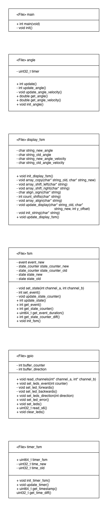

# GSP - Praktikumsaufgabe 2

| Phasenwechsel                     | Ergebnis       |
| --------------------------------- | -------------- |
| Phase `a` $\rightarrow$ Phase `a` | Keine Änderung |
| Phase `a` $\rightarrow$ Phase `b` | Vorwärtslauf   |
| Phase `a` $\rightarrow$ Phase `c` | Fehler         |
| Phase `a` $\rightarrow$ Phase `d` | Rückwärtslauf  |
| Phase `b` $\rightarrow$ Phase `a` | Rückwärtslauf  |
| Phase `b` $\rightarrow$ Phase `b` | Keine Änderung |
| Phase `b` $\rightarrow$ Phase `c` | Vorwärtslauf   |
| Phase `b` $\rightarrow$ Phase `d` | Fehler         |
| Phase `c` $\rightarrow$ Phase `a` | Fehler         |
| Phase `c` $\rightarrow$ Phase `b` | Rückwärtslauf  |
| Phase `c` $\rightarrow$ Phase `c` | Keine Änderung |
| Phase `c` $\rightarrow$ Phase `d` | Vorwärtslauf   |
| Phase `d` $\rightarrow$ Phase `a` | Vorwärtslauf   |
| Phase `d` $\rightarrow$ Phase `b` | Fehler         |
| Phase `d` $\rightarrow$ Phase `c` | Rückwärts      |
| Phase `d` $\rightarrow$ Phase `d` | Keine Änderung |

---

# Modulkonzept

[Modulkonzept - draw.io](./gs_aufgabe_2_modulkonzept.drawio)

# Tests

## Drehgeber

| Ereignis          | Erwartungswert                                                                                                                 | Ergebnis | Durchgeführt am | Softwareversion | Hardware | Protokollant |
| ----------------- | ------------------------------------------------------------------------------------------------------------------------------ | -------- | --------------- | --------------- | -------- | ------------ |
| Stillstand        | Angle: 0 Grad Angle Velocity: 0 Grad/s  Status-LEDs: *aus* State-Counter-LED: *aus*                                |          |                 |                 |          |              |
| Vorwärts langsam  | Angle: *positiv* Grad Angle Velocity: *positiv* Grad/s  Status-LEDs: D23 State-Counter-LEDs: *zählt hoch*          |          |                 |                 |          |              |
| Rückwärts langsam | Angle: *negativ* Grad Angle Velocity: *negativ* Grad/s  Status-LEDs: D22 State-Counter-LEDs: *zählt hoch*          |          |                 |                 |          |              |
| Fehler            | Angle: *eingefroren* Grad Angle Velocity: *eingefroren* Grad/s  Status-LEDs: D21 State-Counter-LEDs: *eingefroren* |          |                 |                 |          |              |
| Reset (S6)        | Angle: "0000.0 Grad" Angle Velocity: 0000.0 Grad/s  Status-LEDs: *aus* State-Counter-LEDs: *aus*                   |          |                 |                 |          |              |

## Pico Rechteckgenerator

**360 Grad & 20 Grad/s**

| Zeit in s | Erwartungswert Angle | Erwartungswert Angle Velocity | Erwartungswert LEDs       | Ergebnis Angle | Ergebnis Angle Velocity | Ergebnis LEDs | Durchgeführt am | Softwareversion | Hardware | Protokollant |
| --------- | -------------------- | ----------------------------- | ------------------------- | -------------- | ----------------------- | ------------- | --------------- | --------------- | -------- | ------------ |
| 0         | "0000.0 Grad"        | "0000.0 Grad/s"               | *aus*                     |                |                         |               |                 |                 |          |              |
| 10        | "0200.0 Grad"        | "0020.0 Grad/s"               | D23, *State-Counter-LEDs* |                |                         |               |                 |                 |          |              |
| 20        | "0360.0 Grad"        | "0000.0 Grad"                 | *State-Counter-LEDs*      |                |                         |               |                 |                 |          |              |

**-360 Grad & 20 Grad/s**

| Zeit in s | Erwartungswert Angle | Erwartungswert Angle Velocity | Erwartungswert LEDs       | Ergebnis Angle | Ergebnis Angle Velocity | Ergebnis LEDs | Durchgeführt am | Softwareversion | Hardware | Protokollant |
| --------- | -------------------- | ----------------------------- | ------------------------- | -------------- | ----------------------- | ------------- | --------------- | --------------- | -------- | ------------ |
| 0         | "0000.0 Grad"        | "0000.0 Grad/s"               | *aus*                     |                |                         |               |                 |                 |          |              |
| 10        | "-0200.0 Grad"       | "-0020.0 Grad/s"              | D22, *State-Counter-LEDs* |                |                         |               |                 |                 |          |              |
| 20        | "-0360.0 Grad"       | "0000.0 Grad"                 | *State-Counter-LEDs*      |                |                         |               |                 |                 |          |              |
